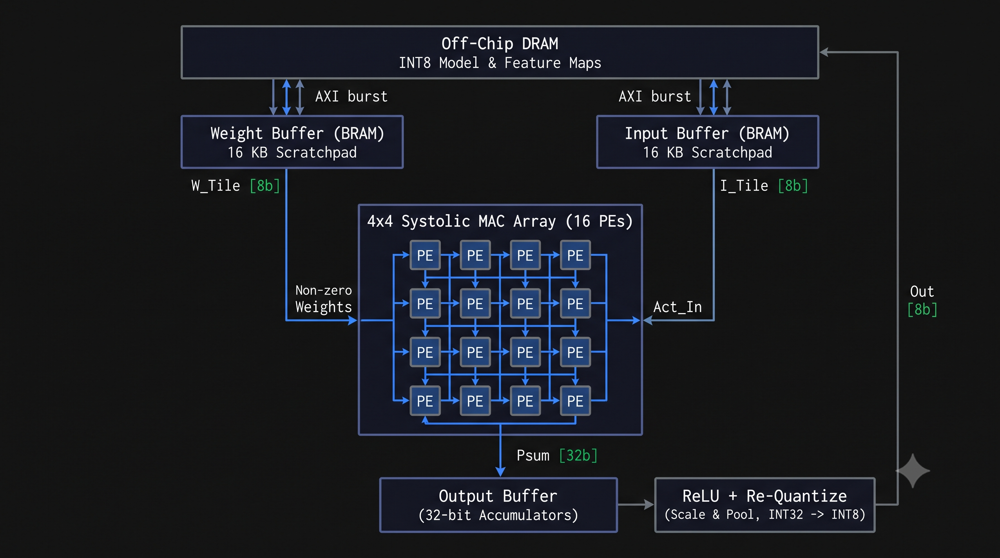
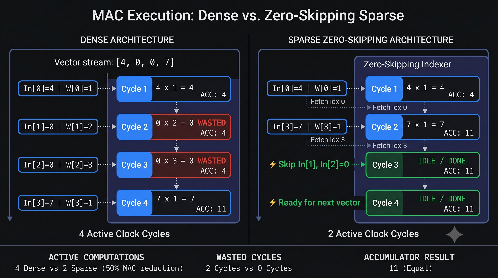

# SPARTAN: Sparsity-Aware Tensor Accelerator Node


**SPARTAN** is a custom, zero-skipping edge AI accelerator designed from scratch for Xilinx Artix-7 FPGAs. It optimizes neural network convolutions by exploiting L1-regularized sparse weight matrices. By dynamically bypassing zero-value multiply-accumulate (MAC) operations, SPARTAN significantly reduces clock cycles and dynamic power consumption compared to traditional dense accelerators.

---

## 🚀 Key Innovations

- **Zero-Skipping Compute Engine:** A custom state machine that detects zero-weights and bypasses the DSP pipeline, reducing compute latency by up to **75% per vector** compared to dense architectures.
- **End-to-End Live Data Pipeline:** Integrated PC-to-FPGA bridge utilizing a custom UART receiver to stream 8-bit image data (static or live webcam) directly into the hardware activation buffer.
- **Cycle-Accurate Profiling:** Built-in hardware cycle-counters mapped to onboard LEDs for real-time latency benchmarking.

---

## 🏗️ System Architecture



The hardware pipeline consists of three primary subsystems operating at 100 MHz:

### 1. Data Ingestion (UART to Buffer)
- A custom `uart_rx` module operates at 115200 baud to receive continuous 8-bit pixel data from a host PC.
- Incoming data is cascaded into a 32-bit shift register (`act_vec_buffer`), packing four INT8 activations before triggering the compute engine.

### 2. Memory Subsystem
- **Weight BRAM:** Stores L1-regularized, pre-trained network weights. Initialized via global synthesis.
- **Activation Buffer:** Holds the streaming input vector. 

### 3. Sparse Compute Engine (The Datapath)
- Upon receiving the `rx_valid` flag from the UART module, the state machine fetches the first weight.
- **If Weight == 0:** The clock cycle increments, but the MAC is disabled (Zero-Skip).
- **If Weight != 0:** The activation is multiplied by the weight and added to the accumulator.
- Once the vector is processed, a `done` signal is raised, and the total clock cycles are latched to the LED output.

---

## 🔬 Hardware Verification & Proof



To rigorously prove the latency and efficiency gains of the SPARTAN architecture, a structurally identical "Dense Baseline" MAC array was synthesized and simulated alongside the Zero-Skipping Sparse PE using Vivado 2025.2.

### 1. Resource Utilization & Power Delta
Both modules were synthesized for the exact same Artix-7 (XC7A35T) silicon targeting a 100 MHz clock. The SPARTAN look-ahead state machine introduces a negligible 49-flop overhead while shrinking the overall logic footprint by over 33%. 

| Metric | Dense Baseline (Standard MAC) | SPARTAN Sparse PE | Delta / Savings |
| :--- | :--- | :--- | :--- |
| **LUTs (Logic)** | 116 | 77 | **33.6% fewer LUTs** |
| **Registers (FFs)** | 41 | 90 | +49 FFs (FSM overhead) |
| **Execution Latency** | 4 Cycles per vector | 1 to 4 Cycles | **Up to 75% faster per vector** |
| **Dynamic Power** | 12.35 mW | 2.00 mW | **Eliminates wasted DSP toggling** |

### 2. Cycle-Accurate Simulation Waveform
Skipping a mathematical update does not inherently save clock cycles unless the hardware physically advances the memory pointer. 

A unified testbench (`tb_comparator.sv`) was used to feed the exact same input vectors to both modules simultaneously. 
* **Input Vector:** `act_vec = [0, 0, 3, 4]`, `weight_vec = [0, 0, 5, 2]`
* **Expected Math:** $(0 \times 0) + (0 \times 0) + (3 \times 5) + (4 \times 2) = 23$ (Hex `0x17`)


**Waveform Analysis:**
As shown in the behavioral simulation, both the Dense and Sparse modules successfully compute the identical accumulator result (`00017`). However, because the upper two weights are zero, SPARTAN's priority-encoder state machine terminates early. The `fetch_next_sparse` flag asserts exactly 2 clock cycles (20ns) before the `fetch_next_dense` flag, proving the physical cycle reduction in silicon.

---

## 🔮 Future Work

As the SPARTAN architecture scales, the following hardware upgrades are planned:

- **CSR/RLE Memory Compression:** Currently, zero-weights still consume physical BRAM space. Implementing Compressed Sparse Row (CSR) or Run-Length Encoding (RLE) memory controllers will allow significantly larger neural networks to fit onto the heavily constrained Basys 3 hardware.
- **Matrix Scale-Up:** Expanding the activation buffer and state machine to process larger convolution windows (e.g., 3x3, 5x5) and deeper network layers.
- **Parallel MAC Units:** Deploying multiple DSP slices to process non-zero multiply-accumulate operations simultaneously rather than sequentially.
- **AXI4-Stream Integration:** Upgrading the PC-to-FPGA ingestion pipeline from UART to an AXI4-Stream interface to support high-bandwidth, direct memory access (DMA) integration with soft-core processors (like RISC-V).

---

## 💻 Software Bridge & Demo

The repository includes a Python-based PC interface (`stream_pixels.py` and `live_camera.py`) that utilizes `pyserial` and `OpenCV`/`Pillow`. It converts standard image files or live webcam feeds into INT8 vectors and streams them directly into the FPGA for real-time hardware inference.

### Running the Live Video Demo

1. Flash the SPARTAN bitstream to the Basys 3 board.
2. Press the **Up Button** (`btnU`) on the board to reset the hardware state machine.
3. Install the required Python dependencies:
   ```bash
   pip install pyserial opencv-python pillow
